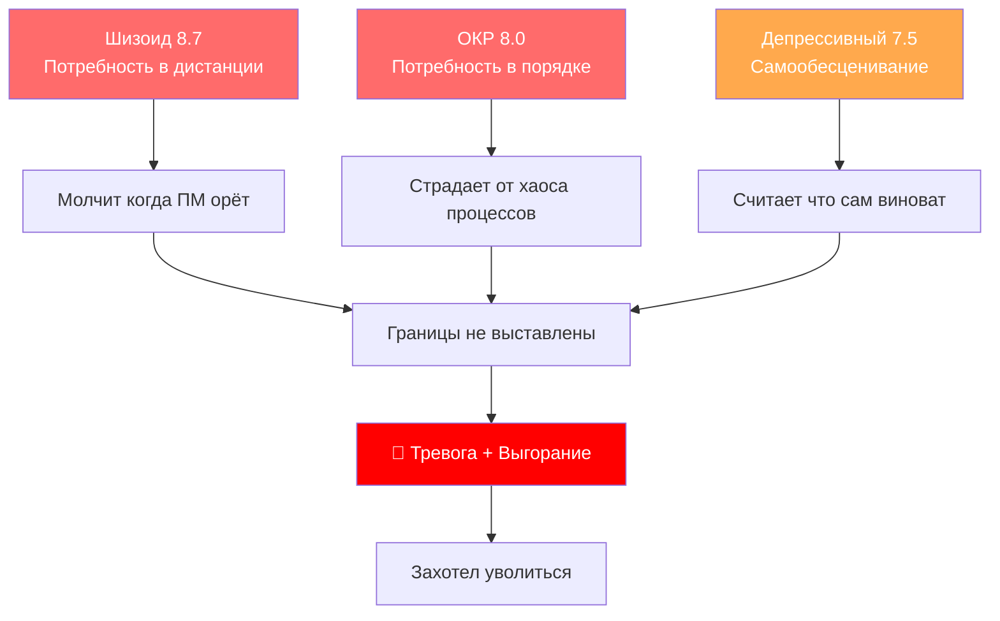

# 🧠 Анализ теста МакВильямс — Улук

> [!NOTE]
> Тест по типологии личности Нэнси МакВильямс — это не диагноз. Это **карта характерологических паттернов**: как человек защищается, строит отношения, переживает стресс. Высокие баллы = выраженность черт, не патология.

---
![[Pasted image 20260505143656.png]]
## 📊 Результаты теста

| Тип личности | Балл | Уровень |
|---|---|---|
| **Шизоидный** | **8.7** | 🔴 Доминантный |
| **Обсессивно-компульсивный** | **8.0** | 🔴 Доминантный |
| **Депрессивный** | **7.5** | 🟠 Выраженный |
| **Истерический** | **7.3** | 🟠 Выраженный |
| **Психопатический** | **7.1** | 🟡 Умеренный |
| **Мазохистический** | **7.1** | 🟡 Умеренный |
| **Депрессивно-маниакальный** | **7.0** | 🟡 Умеренный |
| **Параноидный** | **6.9** | 🟡 Умеренный |
| **Нарциссический** | **6.6** | ⚪ Фоновый |
| **Маниакальный** | **6.4** | ⚪ Фоновый |

---

## 🔍 Глубинный разбор: ТОП-3 доминирующих паттерна

### 1. Шизоидный — 8.7 (самый высокий)

**Что это значит по МакВильямс:**
Шизоидная организация — это не "странность" и не замкнутость в бытовом смысле. Это глубинная потребность в **дистанции** и **автономии**, при которой близость переживается как угроза поглощения.

**Как это проявляется у Улука (по данным дневника и контекста):**

- **"Развитое содержание, не развитая форма"** — классическое шизоидное описание. Внутри богатый мир, снаружи — сдержанность
- **"Не мог найти контакт с командой"** — не потому что не хочет, а потому что близость = уязвимость
- **"Когда я попал в больницу, у меня пропали эмоции"** — шизоидная защита: при перегрузке эмоции отключаются полностью (withdrawal)
- **Сны о преследовании, бегстве, прятках** — базовая шизоидная тревога: мир вторгается, нужно скрыться
- **"Когда говорит о себе — говорит слово 'люди'"** — деперсонализация, дистанцирование от собственных переживаний

> [!IMPORTANT]
> Шизоидный паттерн — это **ядро**. Это объясняет, почему Улук не может "просто поставить границы" — для шизоида любой конфликт = вынужденная близость, а близость = опасность. Ему проще отойти, чем столкнуться.

---

### 2. Обсессивно-компульсивный — 8.0

**Что это значит:**
Потребность в контроле, порядке, предсказуемости. Страх хаоса и потери контроля. Сильная ориентация на правила и "правильность".

**Как проявляется:**

- **"Простота и структура"** — Улук ценит порядок и систему, это его зона комфорта
- **"Организованность и дисциплина"** — он реально хорош когда среда предсказуема
- **"Ввели скрам-мастера → процессы меняются → не привык"** — OCD-паттерн плохо переносит изменения правил
- **"Охуенно работает когда нет тревожки"** — когда контроль есть, он на высоте

> [!WARNING]
> Связка **Шизоид + ОКР = двойная ловушка на работе.** Он хочет идеально делать работу (OCD) но в одиночестве (шизоид). Когда приходит хаотичный ПМ, который "орёт, потом приходит с улыбкой" — это разрушает обе опоры: и предсказуемость, и безопасную дистанцию.

---

### 3. Депрессивный — 7.5

**Что это значит:**
Не "депрессия" как болезнь, а **депрессивная организация**: склонность к самообесцениванию, ощущение что "я недостаточно хорош", трудности с признанием собственных заслуг.

**Как проявляется:**

- **"Не умеет признавать собственные достижения"** — прямое попадание
- **"Считает что за каждым успехом следует расплата"** — классическое депрессивное убеждение: я не заслуживаю хорошего
- **"Хочешь доказать команде что ты сильный разработчик"** — постоянная потребность в подтверждении ценности
- **"Пострадала репутация перед глав фронтом"** — воспринимает это катастрофически, потому что для депрессивного человека репутация = единственное доказательство что он "ок"

---

## 🔗 Связка паттернов: почему рабочая ситуация стала кризисом

**Механизм по шагам:**

1. **Конфликтный ПМ вторгается** → шизоидная защита: "замереть, отойти" (а не "дать отпор")
2. **Процессы хаотичны** → OCD-часть паникует, потому что нет контроля
3. **Молчание воспринимается как слабость** → депрессивная часть подтверждает: "я действительно слабый"
4. **Цикл замыкается** → тревога растёт → работоспособность падает → "я плохой разработчик" → ещё больше тревоги

---

## 🧩 Дополнительные паттерны (фоновые, но важные)

### Истерический — 7.3
- Эмоциональная реактивность есть, но **подавлена шизоидной защитой**
- Это значит внутри он реально переживает, но наружу — сдержан → копит → взрыв или уход

### Мазохистический — 7.1
- Склонность терпеть плохое обращение и находить "смысл" в страдании
- **"Проебанный отпуск"** — характерно: не защитил своё время, потом страдает

### Психопатический — 7.1
- Неожиданно высокий. Это **не про агрессию**, а про способность к стратегическому мышлению и манипулированию ситуацией
- У Улука это **подавленный ресурс**: он умеет анализировать людей и ситуации, но **не разрешает себе** это использовать

### Депрессивно-маниакальный — 7.0
- Качели: "всё отлично, я в потоке" ↔ "всё плохо, хочу уволиться"
- Подтверждается: "охуенно работает без тревожки" ↔ "сгорел и захотел уволиться"

---

## 🎯 Корневая проблема

> [!CAUTION]
> Проблема Улука — **не в ПМ, не в команде и не в процессах**. Это триггеры. Корневая проблема:
> 
> **Шизоидно-обсессивная структура с депрессивным ядром** создаёт человека, который:
> - Нуждается в автономии, но не может её отстоять (шизоид боится конфликта-близости)
> - Нуждается в порядке, но не может его требовать (OCD подавляется страхом отвержения)
> - Нуждается в признании, но не может его принять (депрессивный считает себя недостойным)

---

## 📋 Рекомендации (с учётом профиля)

### 🟢 Что делать СЕЙЧАС (ближайшие 2 недели)

| # | Действие | Почему это работает для его профиля |
|---|---|---|
| 1 | **Письменная коммуникация вместо устной** с проблемным ПМ | Шизоиду легче через текст — это безопасная дистанция. Письменно он сможет выставить границу, которую устно не скажет |
| 2 | **Фиксировать свои достижения** — буквально список в заметке каждый день | Антидот к депрессивному "я ничего не стою". Факты против убеждений |
| 3 | **Определить 3 чётких правила** взаимодействия с командой | OCD-часть получит структуру, тревога снизится |

### 🟡 Среднесрочно (1-3 месяца)

| # | Действие | Почему |
|---|---|---|
| 4 | **Практиковать "микро-конфликты"** — начинать с мелких отказов | Шизоиду нельзя сразу в большой конфликт — он отключится. Нужна постепенная десенсибилизация |
| 5 | **Найти 1 союзника** в команде | Не "дружить со всеми" (это перегрузит шизоида), а один надёжный контакт |
| 6 | **Работать с убеждением** "за успехом следует расплата" | Это депрессивная когнитивная ошибка. Разбирать на конкретных примерах |

### 🔴 Стратегически

| # | Действие | Почему |
|---|---|---|
| 7 | **Терапия** — идеально когнитивно-поведенческая или схема-терапия | Его профиль (шизоид + OCD + депрессивный) — классический кейс для КПТ |
| 8 | **Решить вопрос с Алматы** | "Приехал в Алматы → началась тревожка" — возможно среда сама по себе триггер (оторван от привычного, нет "безопасной базы") |

---

## 💡 Главный инсайт для работы с Улуком

Улук — **не слабый**. Его психопатический балл 7.1 и OCD 8.0 говорят о том, что у него есть и стратегическое мышление, и дисциплина. Проблема в том, что **шизоидная защита + депрессивное самообесценивание** блокируют его силу.

Представь двигатель (OCD-дисциплина + аналитика) с заблокированным сцеплением (шизоидный страх + депрессия). Мотор работает, но колёса не крутятся.

> [!TIP]
> **Ключ к разблокировке** — не "стать смелее" (это бесполезный совет для шизоида), а **создать безопасную структуру** в которой он может проявлять силу. Письменные правила, чёткие роли, предсказуемые процессы — это его среда. Когда среда структурирована, шизоид может выходить из укрытия.

---

*Анализ на основе: тест МакВильямс, дневник Улука (2023-2025), заметки "Клеймо тревожника" (2026-04-30), контекст конфликта с коллегой (2026-04-26)*
